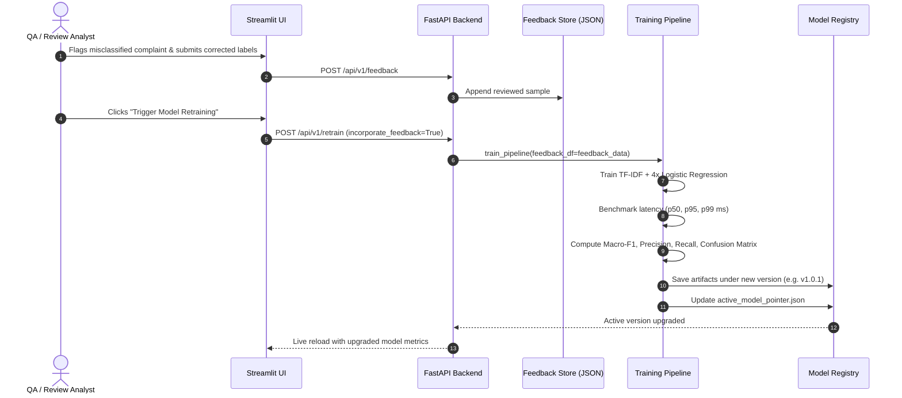

# Architecture Specification: Agentic Customer Insight Platform

## 1. System Overview

The **Agentic Customer Insight Platform** is an enterprise-grade, lightweight MLOps solution designed for real-time customer complaint triage, automated root cause investigation, predictive categorization, and evidence-based remediation.

```mermaid
flowchart TD
    subgraph ClientLayer [Client & Interface Tier]
        UI[Streamlit SaaS Dashboard]
        API_CLIENT[External Systems / Postman / CRM]
    end

    subgraph APILayer [FastAPI Gateway :8000]
        GATEWAY[FastAPI Router & CORS]
        HEALTH[/health]
        PRED_EP[/api/v1/predict]
        ANA_EP[/api/v1/analyze]
        CHAT_EP[/api/v1/chat]
        MLOPS_EP[/api/v1/retrain, /api/v1/models]
    end

    subgraph AgentOrchestrator [Multi-Agent Orchestration Engine]
        A1[Agent 1: Data Validation & PII Redactor]
        A2[Agent 2: Multi-Task ML Classifier]
        A3[Agent 3: Complaint Investigation & Pattern Matcher]
        A4[Agent 4: Multi-Factor Priority & SLA Router]
        A5[Agent 5: Recommendation & Response Synthesizer]
        TRACE[Execution Trace Collector]
    end

    subgraph MLOpsLayer [MLOps & Model Registry]
        REGISTRY[(Versioned Model Registry v1.x)]
        EXPLAIN[Linear Feature Attribution Engine]
        EXP_LOG[(Local Experiment Tracker & MLflow)]
        FEEDBACK[(Active Learning Review Store)]
    end

    ClientLayer --> APILayer
    APILayer --> AgentOrchestrator
    A1 --> A2 --> A3 --> A4 --> A5
    A1 -.-> TRACE
    A2 -.-> TRACE
    A3 -.-> TRACE
    A4 -.-> TRACE
    A5 -.-> TRACE
    A2 <--> REGISTRY
    A2 <--> EXPLAIN
    MLOPS_EP <--> REGISTRY
    MLOPS_EP <--> FEEDBACK
    MLOPS_EP <--> EXP_LOG
```

---

## 2. Multi-Agent Pipeline Specifications

| Agent | Module | Core Functionality | Primary Output |
| :--- | :--- | :--- | :--- |
| **Data Validation Agent** | `src/agents/validation_agent.py` | Input sanity checks, text length validation, automated regex scrubbing of SSN, Credit Cards, Emails, and Phone Numbers. | `is_valid`, `redacted_text`, `pii_detected`, `pii_entities` |
| **Classification Agent** | `src/agents/classification_agent.py` | Multi-task inference over 4 Logistic Regression heads trained on TF-IDF unigrams/bigrams. Produces calibrated confidence scores. | `predicted_category`, `predicted_urgency`, `predicted_sentiment`, `predicted_action`, `confidence` |
| **Complaint Investigation Agent** | `src/agents/investigation_agent.py` | Named entity extraction (disputed monetary amounts, reference IDs, dates) + TF-IDF cosine similarity search over historical cases. | `extracted_entities`, `similar_historical_cases`, `recurring_issue_detected` |
| **Priority Routing Agent** | `src/agents/priority_routing_agent.py` | Objective multi-criteria scoring algorithm (0-100) combining urgency, customer tier, loss amount, and regulatory triggers (e.g. CFPB, lawsuits). | `priority_score`, `priority_tier` (P1-P4), `target_sla_hours`, `target_department` |
| **Recommendation Agent** | `src/agents/recommendation_agent.py` | Synthesizes case findings into step-by-step SOP checklists, drafted customer emails, goodwill credit advice, and statutory compliance notices. | `recommended_sop`, `draft_customer_response`, `compensation_recommendation`, `compliance_notice` |

---

## 3. MLOps Lifecycle & Governance



---

## 4. Performance & Resource Footprint

- **Zero Paid APIs or Cloud Dependencies:** Operates completely offline and locally.
- **Inference Latency:** Sub-millisecond single-case prediction ($p50 \approx 0.67\text{ ms}$, $p95 \approx 1.35\text{ ms}$).
- **Multi-Agent Pipeline Latency:** Full 5-stage orchestration with PII scrubbing, similarity retrieval, and explainability runs in under $120\text{ ms}$.
- **Storage Impact:** Entire model artifacts and dataset footprint are under $10\text{ MB}$.
